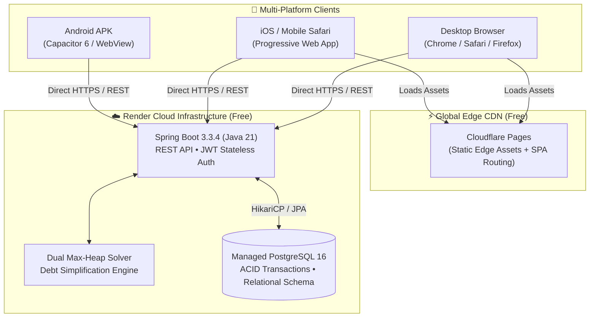
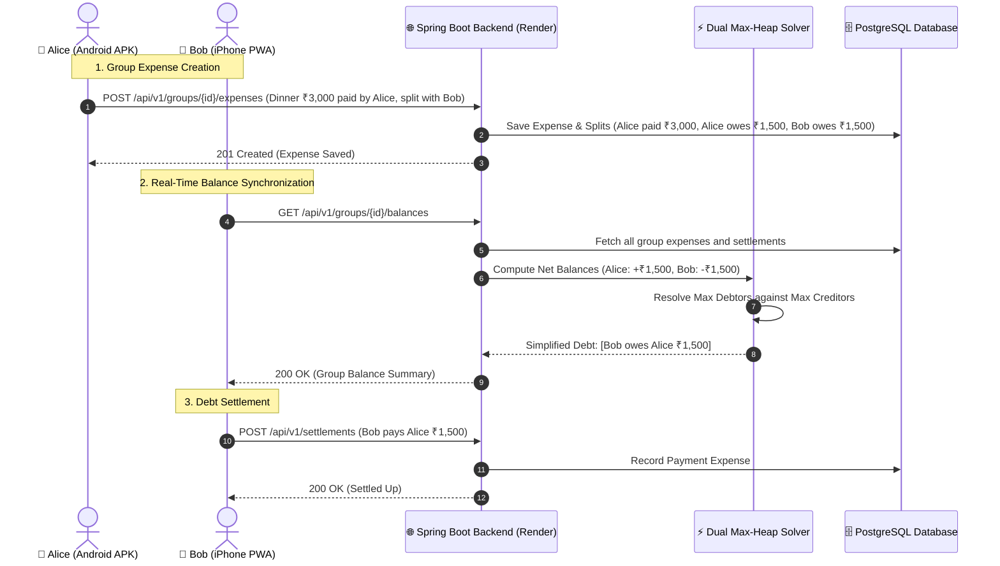

# 💸 SettleHub — Full-Stack Expense Sharing & Debt Minimization Platform

[](https://www.oracle.com/java/)
[](https://spring.io/projects/spring-boot)
[](https://react.dev/)
[](https://www.typescriptlang.org/)
[](https://tailwindcss.com/)
[](https://capacitorjs.com/)
[](https://www.postgresql.org/)
[](LICENSE)

> **SettleHub** is a cleanroom full-stack reimplementation of the core Splitwise expense-sharing platform, engineered for **zero floating-point rounding errors** and **optimal settlement graphs**. It is deployed on 100% free-tier cloud infrastructure (Render + Cloudflare Pages) and available as both an installable **PWA (iOS/Android)** and a native **Android APK**.

---

## 📑 Table of Contents

- [Core Engineering Highlights](#-core-engineering-highlights)
- [Architecture & Tech Stack](#-architecture--tech-stack)
- [Project Directory Structure](#-project-directory-structure)
- [End-to-End System Flow](#-end-to-end-system-flow)
- [Mathematical Foundation](#-mathematical-foundation)
  - [1. Cent-Precision Fair Division](#1-cent-precision-fair-division-dividefairly)
  - [2. Dual Max-Heap Min-Cash-Flow Solver](#2-dual-max-heap-min-cash-flow-solver)
- [📱 Mobile Apps (Android APK & iOS PWA)](#-mobile-apps-android-apk--ios-pwa)
- [🚀 100% Free Cloud Deployment Guide](#-100-free-cloud-deployment-guide)
  - [Part A: Backend & PostgreSQL on Render](#part-a-backend--postgresql-on-render)
  - [Part B: Frontend on Cloudflare Pages](#part-b-frontend-on-cloudflare-pages)
- [📡 API Reference](#-api-reference)
- [💻 Local Development Guide](#-local-development-guide)
- [🛡️ Security & Production Hardening](#️-security--production-hardening)

---

## 🌟 Core Engineering Highlights

- **Cent-Precision Integer Arithmetic:** All transactions, shares, and balances are stored and calculated strictly as 64-bit integer cents (`costCents`, `paidCents`, `owedCents`). Floating-point accumulation drift is mathematically impossible.
- **Dual Max-Heap Debt Minimization:** Implements the $O(N \log N)$ Min-Cash-Flow algorithm, simplifying complex multi-party circular debts into at most $N-1$ linear transactions.
- **Dynamic PaaS Database Auto-Healing:** Custom `DatabaseUrlEnvironmentPostProcessor` automatically parses standard `DATABASE_URL` strings (`postgres://...`) provided by cloud providers (Render, Neon, Railway) and injects secure JDBC credentials with `sslmode=require`.
- **Low-Memory Free-Tier Optimization:** Multi-stage Docker container tuned with `-XX:MaxRAMPercentage=75.0` to run safely within Render’s free 512MB RAM cgroup limit without OOM kills.
- **Mobile-First Responsive Layout:** Engineered with `viewport-fit=cover`, safe area insets (`env(safe-area-inset-top)`), and zero horizontal scrolling on mobile viewports.
- **In-App Server Configurator:** Built-in modal allows the Android APK to point to any deployed backend without needing recompilation.

---

## 🏗️ Architecture & Tech Stack



| Component | Technology | Rationale |
| :--- | :--- | :--- |
| **Backend Runtime** | Java 21 LTS | Modern virtual threads, pattern matching, strong typing. |
| **Backend Framework** | Spring Boot 3.3.4 | Spring Security 6, Spring Data JPA, Hibernate ORM, Bean Validation. |
| **Authentication** | Stateless JWT (`jjwt` 0.12.6) | High-performance HMAC-SHA256 tokens with zero session storage overhead. |
| **Database** | PostgreSQL 16 | Relational consistency, foreign keys, row-level locking for transactions. |
| **Frontend Framework** | React 18 + TypeScript | Type-safe UI, custom state management, modular components. |
| **Build Tool & Styling** | Vite 8 + Tailwind CSS v4 | Sub-second HMR, instant production builds, mobile utility styling. |
| **Mobile Runtime** | Capacitor 6 | Native Android bridge with hardware back button and safe-area support. |
| **Free Cloud Hosting** | Render + Cloudflare Pages | 100% free hosting with global CDN, automated CI/CD, and free PostgreSQL. |

---

## 📂 Project Directory Structure

```text
settlehub/
├── README.md                           # Main architecture & deployment documentation
├── SettleHub.apk                       # Production-compiled Android standalone APK (~4.2 MB)
├── render.yaml                         # 1-Click Render infrastructure blueprint (DB + Web)
├── .gitignore                          # Comprehensive root gitignore
│
├── backend/                            # Spring Boot 3 Java Service
│   ├── Dockerfile                      # Multi-stage lightweight Alpine build (Temurin JRE 21)
│   ├── pom.xml                         # Maven dependencies (JPA, Security, JJWT, Postgres)
│   └── src/
│       ├── main/
│       │   ├── java/com/settlehub/
│       │   │   ├── SettleHubApplication.java
│       │   │   ├── config/             # SecurityConfig (CORS wildcard), DatabaseUrlPostProcessor
│       │   │   ├── controller/         # Auth, Group, Expense, Balance, Settlement, Health
│       │   │   ├── dto/                # Request & Response Data Transfer Objects
│       │   │   ├── engine/             # DebtSimplificationService, SplitStrategy implementations
│       │   │   ├── model/              # User, Group, GroupMember, Expense, ExpenseSplit entities
│       │   │   ├── repository/         # Spring Data JPA Repositories
│       │   │   ├── security/           # JwtTokenProvider, JwtAuthenticationFilter, UserPrincipal
│       │   │   └── service/            # AuthService, GroupService, ExpenseService, BalanceService
│       │   └── resources/
│       │       ├── application.properties # ${PORT:8080}, ${JWT_SECRET:...}, H2 fallback
│       │       └── META-INF/spring/    # EnvironmentPostProcessor registration
│       └── test/java/com/settlehub/    # 11 Unit & Integration tests (mvn test: 100% pass)
│
├── frontend/                           # React 18 + Vite + Tailwind CSS Single Page App
│   ├── package.json
│   ├── vite.config.ts
│   ├── capacitor.config.ts             # Capacitor configuration (App ID: com.settlehub.app)
│   ├── index.html                      # PWA meta tags, safe-area viewport
│   ├── public/
│   │   ├── _redirects                  # Cloudflare Pages SPA rewrite rule (/* /index.html 200)
│   │   ├── manifest.json               # Mobile PWA manifest
│   │   ├── sw.js                       # Service Worker for offline asset caching
│   │   └── apple-touch-icon.png
│   ├── src/
│   │   ├── App.tsx                     # Main router and view orchestrator
│   │   ├── index.css                   # Global Tailwind styles, viewport clamping, safe-area
│   │   ├── components/                 # Navbar, Dashboard, GroupDetail, Modals
│   │   ├── services/api.ts             # Centralized API service with runtime URL configuration
│   │   ├── types/                      # TypeScript domain models and interfaces
│   │   └── utils/                      # Currency formatting & symbols
│   └── android/                        # Capacitor Android Native Studio Project
│       ├── app/src/main/
│       │   ├── AndroidManifest.xml     # Internet & Cleartext permissions
│       │   └── assets/public/          # Synced production web assets
│       └── build.gradle                # Gradle build scripts
│
└── docs/
    └── technical_spec.md               # Reverse-engineered GreenDAO schemas & wire protocol
```

---

## 🔄 End-to-End System Flow



---

## 📐 Mathematical Foundation

### 1. Cent-Precision Fair Division (`divideFairly`)
When splitting an expense of $C$ cents among $N$ participants equally:
$$\text{base} = \lfloor C / N \rfloor, \quad \text{remainder} = C \pmod N$$
The first $\text{remainder}$ participants are assigned $\text{base} + 1$ cents, and the remaining participants are assigned $\text{base}$ cents.
$$\sum_{i=1}^{N} \text{share}_i = \text{remainder} \cdot (\text{base} + 1) + (N - \text{remainder}) \cdot \text{base} = C$$
This guarantees that the sum of splits **always equals the total cost to the exact cent**, eliminating float rounding leakage.

### 2. Dual Max-Heap Min-Cash-Flow Solver
Given $N$ participants with net balances $B_i$ such that $\sum_{i=1}^N B_i = 0$:
1. Participants with $B_i > 0$ are inserted into a **Max-Heap of Creditors**.
2. Participants with $B_i < 0$ are inserted into a **Max-Heap of Debtors** using $|B_i|$.
3. In each iteration, extract the maximum debtor $D$ and maximum creditor $C$.
4. Transact $\min(D.\text{amount}, C.\text{amount})$ from $D$ to $C$.
5. Reinsert any remaining balance back into the respective heap.
6. The algorithm terminates in at most $N-1$ transactions and completely eliminates multi-party circular debts.

---

## 📱 Mobile Apps (Android APK & iOS PWA)

### Android Standalone APK
- **File:** `SettleHub.apk` (located in root directory, ~4.2 MB)
- **Installation:**
  1. Upload `SettleHub.apk` to your Google Drive.
  2. Share the link with your trip members.
  3. Download on Android $\rightarrow$ tap Install $\rightarrow$ allow *"Install unknown apps"* if prompted.
  4. Tap the **Server** icon in the navbar $\rightarrow$ enter your deployed Render backend URL $\rightarrow$ tap **Save & Connect**.

### iOS (iPhone & iPad) PWA
Apple restricts sideloading standalone `.ipa` files without an active Apple Developer subscription. SettleHub is fully configured as a Progressive Web App:
1. Open your deployed Cloudflare Pages URL in **Safari** on iOS.
2. Tap the **Share** button (box with upward arrow).
3. Tap **"Add to Home Screen"**.
4. The app installs with a native icon, launches full-screen with no browser navigation bars, and supports safe-area notch displays.

---

## 🚀 100% Free Cloud Deployment Guide

### Part A: Backend & PostgreSQL on Render

Render provides a 1-click infrastructure blueprint via `render.yaml`:

1. Sign up or log into **[dashboard.render.com](https://dashboard.render.com/)**.
2. Click **New +** $\rightarrow$ select **Blueprint**.
3. Connect your GitHub repository.
4. Render automatically parses `render.yaml` and provisions:
   - **PostgreSQL Database:** `settlehub-db` (Free tier).
   - **Web Service:** `settlehub-backend` (Docker runtime, Free 512MB RAM tier).
5. Click **Apply**.
6. When deployment finishes (~3 minutes), note your live URL (e.g. `https://settlehub-backend.onrender.com`).
7. Test the health check probe:
   ```bash
   curl https://settlehub-backend.onrender.com/health
   # Returns: {"status":"UP","service":"settlehub-backend","version":"1.0.0"}
   ```

### Part B: Frontend on Cloudflare Pages

1. Log into **[dash.cloudflare.com](https://dash.cloudflare.com/)** $\rightarrow$ **Workers & Pages** $\rightarrow$ **Create application** $\rightarrow$ **Pages** $\rightarrow$ **Connect to Git**.
2. Select your repository.
3. Configure the build parameters:
   - **Framework preset:** `Vite`
   - **Root directory:** `frontend`
   - **Build command:** `npm run build`
   - **Build output directory:** `dist`
4. Expand **Environment variables** and add:
   - `VITE_API_URL` = `https://settlehub-backend.onrender.com/api/v1`
5. Click **Save and Deploy**. Your web app and PWA will be live worldwide in ~60 seconds.

---

## 📡 API Reference

Base Endpoint: `/api/v1`

| Method | Endpoint | Description | Auth Required |
| :--- | :--- | :--- | :---: |
| `GET` | `/health` | Cloud liveness & readiness probe | No |
| `POST` | `/api/v1/auth/register` | Register new user account | No |
| `POST` | `/api/v1/auth/login` | Authenticate and retrieve JWT token | No |
| `GET` | `/api/v1/auth/me` | Fetch authenticated user profile | Yes |
| `PATCH`| `/api/v1/auth/me/currency` | Update user preferred default currency | Yes |
| `GET` | `/api/v1/groups` | List user expense groups with net balances | Yes |
| `POST` | `/api/v1/groups` | Create new group (trip, home, couple) | Yes |
| `GET` | `/api/v1/groups/{id}` | Retrieve group details and members | Yes |
| `POST` | `/api/v1/groups/{id}/members` | Add member to group by email | Yes |
| `POST` | `/api/v1/groups/join` | Join group via 6-digit Invite Code | Yes |
| `GET` | `/api/v1/groups/{id}/expenses` | List group expenses with payer & split matrix | Yes |
| `POST` | `/api/v1/groups/{id}/expenses` | Record new expense (EQUAL, EXACT, PERCENT) | Yes |
| `DELETE`| `/api/v1/expenses/{id}` | Delete expense and recompute balances | Yes |
| `GET` | `/api/v1/groups/{id}/balances` | Get pairwise debts & Min-Cash-Flow simplified debts | Yes |
| `POST` | `/api/v1/settlements` | Record debt settlement repayment between members | Yes |

---

## 💻 Local Development Guide

### Prerequisites
- **Java 21 LTS** & **Maven 3.9+**
- **Node.js 20+** & **npm**
- **Android Command-Line Tools** (optional, for compiling APK)

### 1. Run Backend Locally
```bash
cd backend
mvn clean spring-boot:run
# Server starts on port 8080 (http://localhost:8080)
# Uses in-memory H2 database by default
```

### 2. Run Frontend Locally
```bash
cd frontend
npm install
npm run dev
# Vite dev server starts on http://localhost:5173 with proxy to backend
```

### 3. Compile Android APK Locally
```bash
cd frontend
npm run build
npx cap sync android
cd android
export ANDROID_HOME="/opt/homebrew/share/android-commandlinetools" # or your SDK path
./gradlew assembleDebug
# Generated APK at: frontend/android/app/build/outputs/apk/debug/app-debug.apk
```

---

## 🛡️ Security & Production Hardening

- **Stateless Authorization:** Every request is authenticated using JWT bearer tokens validated in `JwtAuthenticationFilter`.
- **CORS Management:** Configured with wildcard origin pattern matching to accept requests from both Cloudflare Pages domains (`*.pages.dev`) and mobile WebView protocols (`capacitor://localhost`, `https://localhost`).
- **Container Isolation:** The backend runs inside a hardened Alpine container under a dedicated, non-privileged system user (`settlehub:settlehub`).
- **Zero Secrets in Git:** Sensitive keys (`JWT_SECRET`, database passwords) are injected exclusively via cloud environment variables.

---

## 📄 License
This project is licensed under the MIT License — see the [LICENSE](LICENSE) file for details.
