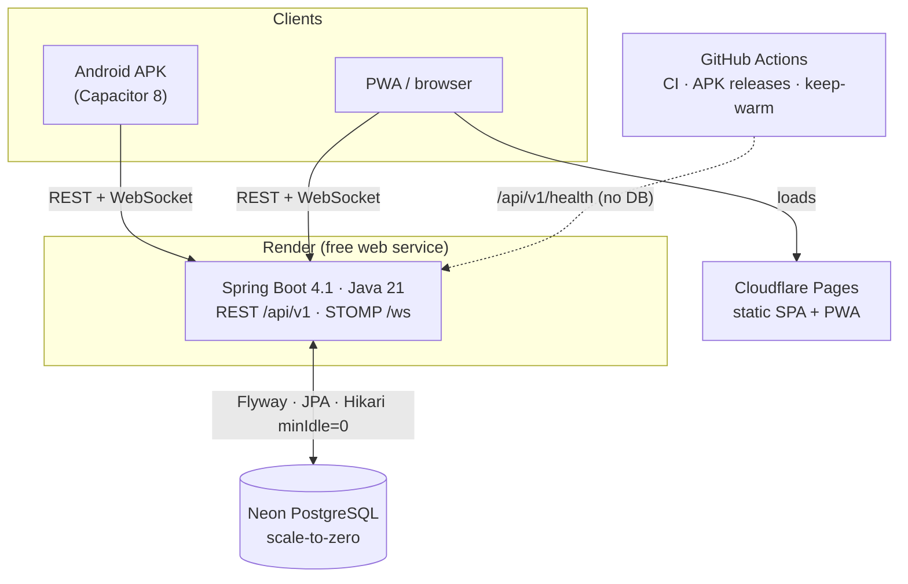

# 💸 SettleHub 3.0 — Real-Time Group Expense Sharing

[](https://github.com/byte2code/settlehub/actions/workflows/ci.yml)
[](https://adoptium.net/)
[](https://spring.io/projects/spring-boot)
[](https://react.dev/)
[](https://capacitorjs.com/)
[](https://neon.tech/)
[](LICENSE)
[](https://github.com/byte2code/settlehub/releases/latest/download/SettleHub.apk)

> **SettleHub** splits group expenses (trips, flats, dinners) exactly to the paisa, keeps everyone in sync live, and settles debts in the fewest payments. It runs entirely on free tiers (**$0/month**: Render + Neon + Cloudflare Pages + GitHub Actions) and ships as a web app, an installable PWA and an Android APK.

---

## 📑 Contents

- [What's new in 3.0](#-whats-new-in-30)
- [Features](#-features)
- [Architecture](#️-architecture)
- [Maths](#-maths)
- [Mobile apps](#-mobile-apps)
- [Free deployment ($0/month)](#-free-deployment-0month)
- [Configuration](#️-configuration)
- [Upgrading from 2.0](#️-upgrading-from-20)
- [Local development](#-local-development)
- [API reference](#-api-reference)
- [Security](#️-security)

---

## 🆕 What's new in 3.0

The full audit and plan are in [`docs/settlehub_3.0_plan.md`](docs/settlehub_3.0_plan.md).

**Security fixes (upgrade recommended)**
- In 2.0 any logged-in user could read or change **any** group by its id. Every endpoint and live-update subscription now checks group membership; admin-only actions are enforced.
- 2.0 shipped a fallback JWT secret in this public repository, so anyone could forge a login. The backend now **refuses to start against PostgreSQL without its own `JWT_SECRET`**.
- WebSocket connections need a valid token; login is rate limited; wrong passwords return 401 instead of 500.

**Bug fixes**
- “Settle” recorded payments in the wrong direction, and settlements were duplicated as expenses. Both fixed; payments can now be undone.
- People added to a group by email can now sign up and claim their account.
- Dashboard totals are split by currency instead of adding rupees to dollars.

**New**
- Activity feed, member management (remove, leave, promote to admin), invite-code reset, deep links (`/groups/:id`, `/join/:code`).
- UPI ID on your profile and one-tap **UPI pay links** when settling up in INR.
- Foreign-currency expenses converted at a live rate ([Frankfurter](https://frankfurter.dev)) or one you type in; the original amount is kept.
- CSV export, light/dark/system theme, toasts and accessible dialogs, a proper offline-capable PWA with update prompt.
- Database schema managed by **Flyway** migrations; existing 2.0 databases are upgraded in place.
- Faster cold starts on Render (Class Data Sharing), CI on every push, and APKs built and published automatically on release tags.

---

## ✨ Features

| | |
| :--- | :--- |
| **Exact splits** | Equal, exact amounts or percentages, with multiple payers. All money is integer cents, so splits always add up. |
| **Fewest payments** | Optional debt simplification turns a web of IOUs into at most *N−1* payments. |
| **Live for everyone** | Changes appear instantly for every member over WebSockets, no refresh needed. |
| **Any currency** | Each group has a currency; foreign expenses are converted and the original amount is kept. `Intl` formatting (₹1,23,456.00, ¥1,235). |
| **Quick entry** | Type *“Dinner 1500 paid by Alice”* and the form fills itself (parsed offline, in the browser). |
| **Settle up** | Record payments, undo them, pay via UPI deep link. |
| **Budgets & archive** | Trip budgets with a progress bar; archive finished groups. |
| **Receipts** | Photos compressed in the browser and attached to expenses. |
| **Export** | CSV, Excel (multi-sheet `.xlsx`) and a WhatsApp summary. |
| **Activity** | A feed of who added, edited or settled what. |
| **Apps** | Installable PWA (iOS/Android/desktop) and an Android APK with hardware back button support. |

---

## 🏗️ Architecture



| Layer | Technology |
| :--- | :--- |
| Backend | Java 21, Spring Boot 4.1 (Hibernate 7, Jackson 3), Spring Security, virtual threads |
| Database | PostgreSQL on Neon; Flyway migrations; in-memory H2 for local development and tests |
| Real time | Spring's built-in STOMP broker, JWT-authenticated, per-group topics |
| Frontend | React 19, TypeScript, Vite, Tailwind CSS v4, React Router, TanStack Query |
| PWA | `vite-plugin-pwa` (Workbox), network-first navigation, update prompt |
| Mobile | Capacitor 8 (Android) |
| Tests | JUnit + MockMvc (backend), Vitest (frontend), both in CI |

### Project layout

```text
settlehub/
├── render.yaml                 # Render Blueprint (backend; database is Neon)
├── .github/workflows/          # ci.yml, release-apk.yml, keep-warm.yml
├── backend/
│   ├── Dockerfile              # CDS-trained image tuned for 0.1 CPU / 512 MB
│   └── src/main/
│       ├── java/com/settlehub/ # config, controller, dto, engine, model, repository, security, service
│       └── resources/db/migration/   # Flyway: V1 (2.0 baseline), V2 (3.0)
├── frontend/
│   ├── src/pages/              # Dashboard, GroupPage, Join, Landing
│   ├── src/components/         # ui/, layout/, group/, modals/
│   ├── src/hooks/              # queries (TanStack Query), live socket, auth, theme
│   ├── src/lib/                # api, money, quick-entry parser, fx, upi, csv
│   └── android/                # Capacitor Android project
└── docs/                       # 3.0 plan, deployment runbook, handoff notes
```

---

## 📐 Maths

### Cent-precision fair division
Splitting $C$ cents among $N$ people equally:
$$\text{base} = \lfloor C / N \rfloor, \quad \text{remainder} = C \bmod N$$
The first $\text{remainder}$ people get $\text{base} + 1$ cents and the rest get $\text{base}$, so the shares always add up to exactly $C$.

### Minimum cash flow
With net balances $B_i$ where $\sum B_i = 0$:
1. Put creditors ($B_i > 0$) in one max-heap and debtors ($|B_i|$ for $B_i < 0$) in another.
2. Repeatedly take the largest debtor and largest creditor, and transfer $\min(D, C)$.
3. Push back whoever still has a balance.

This finishes in at most $N-1$ payments.

---

## 📱 Mobile apps

### Android
Download **[SettleHub.apk](https://github.com/byte2code/settlehub/releases/latest/download/SettleHub.apk)** from the [latest release](https://github.com/byte2code/settlehub/releases/latest), open it and tap **Install** (allow *Install unknown apps* if asked). The APK is built by GitHub Actions for every `v*` tag and already points at the hosted backend; the **Server** icon in the app lets you point it elsewhere.

> Coming from the 2.0 APK? It was signed with a different key, so uninstall 2.0 first.

### iPhone / iPad (PWA)
Open the web app in Safari → **Share** → **Add to Home Screen**. It runs full screen and updates itself.

---

## 🚀 Free deployment ($0/month)

| Piece | Service | Free allowance | How SettleHub stays inside it |
| :--- | :--- | :--- | :--- |
| Backend | Render web service | 512 MB, 0.1 CPU, 750 h/month; sleeps after 15 idle min | One instance; CDS + SerialGC + C1 for faster wake-up |
| Database | Neon | 0.5 GB, scale-to-zero | No idle connections (Hikari `minimumIdle=0`); health checks don't touch the DB |
| Frontend | Cloudflare Pages | Unlimited static bandwidth, 500 builds/month | Static SPA + PWA |
| CI & APK | GitHub Actions | Free on public repos | Tests on push/PR, APK on tags |
| FX rates | Frankfurter | Free, no key | Fetched by the browser on demand |
| Payments | UPI deep links | Free | `upi://pay` intent, no gateway |

Step-by-step instructions are in **[docs/deployment.md](docs/deployment.md)**. In short:

1. **Neon**: create a project and copy its connection string.
2. **Render**: *New → Blueprint* → this repo. Paste the Neon string as `DATABASE_URL`. `JWT_SECRET` is generated for you.
3. **Cloudflare Pages**: root `frontend`, build `npm run build`, output `dist`, env `VITE_API_URL=https://<your-service>.onrender.com/api/v1`.
4. **GitHub**: set the repository variable `SETTLEHUB_API_URL` (same value as `VITE_API_URL`), then push a tag such as `v3.0.0` to publish the APK.

---

## ⚙️ Configuration

Backend environment variables:

| Variable | Default | Purpose |
| :--- | :--- | :--- |
| `DATABASE_URL` | *(unset → in-memory H2)* | `postgres://` / `postgresql://` / `jdbc:` URL, e.g. from Neon |
| `JWT_SECRET` | *(required with PostgreSQL)* | 32+ random characters (`openssl rand -hex 32`). Changing it logs everyone out |
| `APP_CORS_ALLOWED_ORIGINS` | localhost, `https://*.pages.dev`, the Android app | Comma-separated origin patterns; add a custom frontend domain here |
| `APP_SEED_DEMO_DATA` | `auto` | `auto` seeds demo users only on H2; `true`/`false` to force |
| `APP_AUTH_RATE_LIMIT` | `10` | Login/register attempts per minute per client |
| `APP_RECEIPT_MAX_CHARS` | `480000` | Largest receipt photo accepted (data-URL length, about 350 KB) |
| `JWT_EXPIRATION_MS` | `2592000000` (30 days) | Session length |
| `PORT` | `8080` | HTTP port (Render sets this) |

Frontend build variables: `VITE_API_URL`, the backend's `/api/v1` URL (defaults to `/api/v1` on the same origin), and optionally `VITE_PUBLIC_WEB_URL`, the web app's address, so invite links shared from the Android app open the website (without it the app shares just the code).

GitHub repository settings used by the workflows:

| Name | Kind | Used by |
| :--- | :--- | :--- |
| `SETTLEHUB_API_URL` | variable | `release-apk.yml`: backend URL baked into the APK (required) |
| `SETTLEHUB_WEB_URL` | variable | `release-apk.yml`: web app address used for invite links in the APK (optional) |
| `SETTLEHUB_BACKEND_URL` | variable | `keep-warm.yml`: enables the keep-warm ping (optional) |
| `ANDROID_KEYSTORE_BASE64`, `ANDROID_KEYSTORE_PASSWORD`, `ANDROID_KEY_ALIAS`, `ANDROID_KEY_PASSWORD` | secrets | `release-apk.yml`: sign the APK with your own key so updates install over each other (recommended) |

---

## ⬆️ Upgrading from 2.0

1. Set `JWT_SECRET` (`openssl rand -hex 32`) on the backend. It will not start against PostgreSQL without one. Because 2.0's secret was public, a new secret logs everyone out once; that is intended.
2. Keep `DATABASE_URL` pointing at your database (or move to Neon; see [deployment](docs/deployment.md)). On first start Flyway records the existing 2.0 schema as version 1 and applies the 3.0 migration: receipts move to their own table and nothing is deleted.
3. If the frontend is on a custom domain, add it to `APP_CORS_ALLOWED_ORIGINS`.
4. Old “payment” expenses that 2.0 created when settling stay in the database but are hidden from the expense list; the payments history is the source of truth.
5. Android users need to uninstall the 2.0 APK before installing 3.0 (different signing key).

---

## 💻 Local development

Requirements: **Java 21+**, **Maven 3.9+**, **Node 22+**.

```bash
# Backend on in-memory H2 with demo users alice@ / bob@settlehub.com (password: password123)
cd backend
mvn test
mvn spring-boot:run -Dspring-boot.run.jvmArguments=-Dapp.database-url.enabled=false
```

Without that flag the backend uses a `DATABASE_URL` from your shell or from a `.env.local` / `.env` file in `backend/` or the repo root, and then also needs `JWT_SECRET`. Use a [Neon branch](https://neon.tech/docs/introduction/branching) rather than your production database for this. Tests always use H2.

```bash
# Frontend on http://localhost:3000; proxies /api and /ws to :8080
cd frontend
npm ci
npm test && npm run lint
npm run dev
```

Build the Android APK locally (needs the Android SDK):

```bash
cd frontend
VITE_API_URL=https://<your-service>.onrender.com/api/v1 npm run build
npx cap sync android
cd android && ./gradlew assembleDebug
# → frontend/android/app/build/outputs/apk/debug/app-debug.apk
```

---

## 📡 API reference

All routes are under `/api/v1` and need `Authorization: Bearer <token>` unless marked public. Group routes return 404 to non-members.

| Method | Path | Description |
| :--- | :--- | :--- |
| `GET` | `/health` | Liveness, no database (public) |
| `GET` | `/health/ready` | Readiness, checks the database (public) |
| `POST` | `/auth/register`, `/auth/login` | Create account / sign in (public, rate limited) |
| `GET` `PATCH` | `/auth/me` | Profile (name, UPI ID, default currency) |
| `POST` | `/auth/me/password` | Change password |
| `GET` `POST` | `/groups` | List / create groups |
| `GET` `PUT` `DELETE` | `/groups/{id}` | Group details / settings / delete (admin) |
| `POST` | `/groups/{id}/members` | Add a member by email |
| `PATCH` `DELETE` | `/groups/{id}/members/{userId}` | Promote / remove a member (admin) |
| `POST` | `/groups/{id}/leave` | Leave a group |
| `POST` | `/groups/{id}/invite-code` | Reset the invite code (admin) |
| `GET` | `/groups/invite/{code}` | Preview a group from its invite code |
| `POST` | `/groups/join` | Join with an invite code |
| `GET` | `/groups/{id}/activity` | Activity feed |
| `GET` `POST` | `/groups/{id}/expenses` | List / add expenses (EQUAL, EXACT, PERCENT) |
| `PUT` `DELETE` | `/expenses/{id}` | Edit / delete an expense |
| `GET` | `/expenses/{id}/receipt` | Receipt photo |
| `GET` | `/groups/{id}/balances` | Net balances, direct and simplified debts |
| `GET` | `/groups/{id}/settlements` | Payment history |
| `POST` | `/settlements` | Record a payment |
| `DELETE` | `/settlements/{id}` | Undo a payment |
| `GET` | `/groups/{id}/export/excel`, `/groups/{id}/export/whatsapp` | Excel workbook / WhatsApp text |
| `POST` | `/groups/{id}/export/email` | Email a report (only if SMTP is configured via `spring.mail.*`) |
| `WS` | `/ws` (not under `/api/v1`) | STOMP; send the JWT on CONNECT, subscribe to `/topic/groups/{id}` |

---

## 🛡️ Security

- Every group endpoint and WebSocket subscription checks membership; admin actions check the role.
- Stateless JWT (HMAC-SHA256) with a required, private secret in production; no secret in the repository.
- Rate-limited login and registration; passwords hashed with BCrypt, 8 characters minimum.
- CORS limited to known origins (Cloudflare Pages, localhost, the Android WebView, and whatever you add).
- TLS to the database (`sslmode=require`); `.env*` files are gitignored and excluded from Docker builds.

---

## 📄 License

MIT. See [LICENSE](LICENSE).
