# SettleHub 3.0 — Architecture & Workflows

How the pieces fit together, and what happens behind each screen. Every diagram is drawn from
the code on `main`; file names are given so you can follow along.

- [1. System overview](#1-system-overview)
- [2. Backend request pipeline](#2-backend-request-pipeline)
- [3. Data model](#3-data-model)
- [4. From expense to “who owes whom”](#4-from-expense-to-who-owes-whom)
- [5. Live updates between members](#5-live-updates-between-members)
- [6. Settle up, UPI and undo](#6-settle-up-upi-and-undo)
- [7. Invites, joining and claiming an account](#7-invites-joining-and-claiming-an-account)
- [8. Foreign-currency expenses](#8-foreign-currency-expenses)
- [9. Receipts](#9-receipts)
- [10. Frontend structure](#10-frontend-structure)
- [11. Waking the free backend](#11-waking-the-free-backend)
- [12. Upgrading a 2.0 database](#12-upgrading-a-20-database)
- [13. Build, test and release pipeline](#13-build-test-and-release-pipeline)
- [14. Backend Docker image](#14-backend-docker-image)
- [15. Activity feed events](#15-activity-feed-events)

---

## 1. System overview

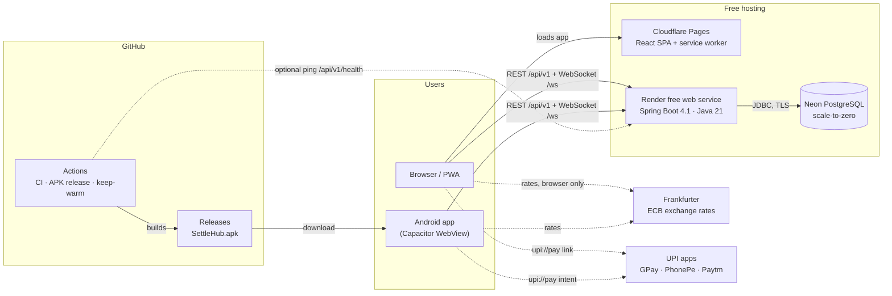

Nothing in this picture costs money: see the [free-tier budget](settlehub_3.0_plan.md#4-free-tier-budget).

---

## 2. Backend request pipeline

Every REST call passes the same checks. A group you are not in looks exactly like a group that
does not exist (404), so ids can't be probed.

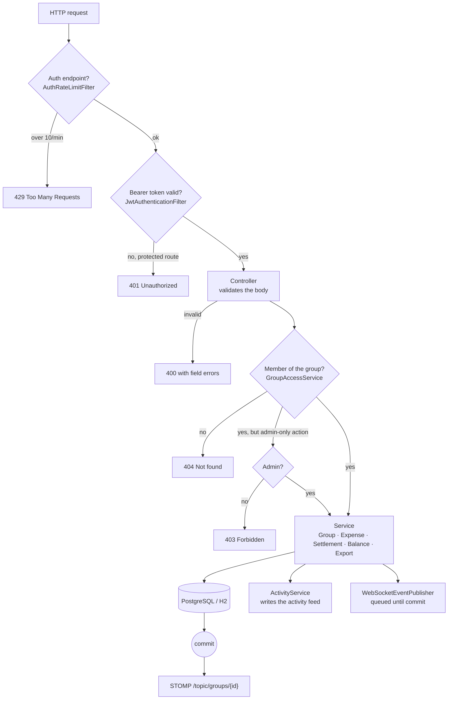

| Code | When |
| --- | --- |
| 400 | Validation failed (amounts don't add up, password too short, bad UPI ID) |
| 401 | No/expired token, or wrong email/password |
| 403 | Signed in and a member, but the action needs an admin (or the payer/payee for undo) |
| 404 | Not a member, or the thing doesn't exist |
| 409 | Conflict, e.g. email already registered, leaving a group while you still owe money |
| 429 | More than `APP_AUTH_RATE_LIMIT` sign-in/sign-up attempts a minute |

---

## 3. Data model

Flyway owns the schema: `V1__baseline_2_0_schema.sql` (2.0, unchanged) and `V2__settlehub_3_0.sql`.

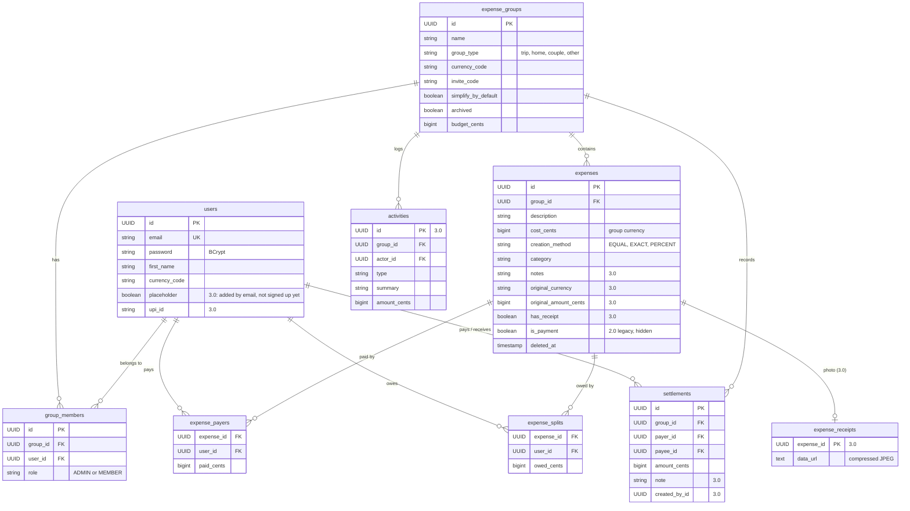

All money is stored as whole cents (`BIGINT`), never floating point.

---

## 4. From expense to “who owes whom”

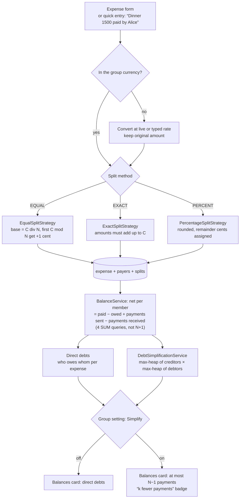

Splits always add up to the exact total: ₹999 split three ways by 33.33% each is stored as
333.00 + 333.00 + 333.00, not 332.97 × 3.

---

## 5. Live updates between members

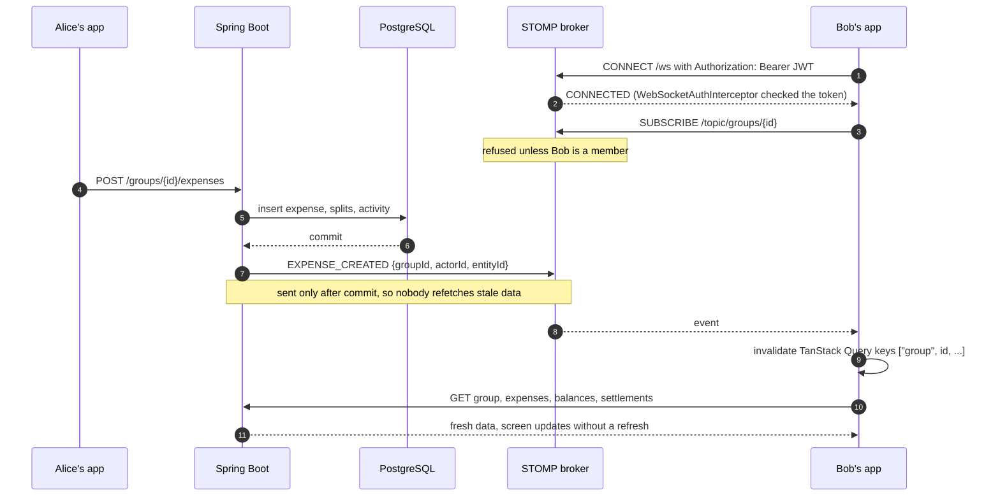

Events: `EXPENSE_CREATED/UPDATED/DELETED`, `SETTLEMENT_RECORDED/DELETED`, `GROUP_UPDATED`,
`GROUP_DELETED`, `MEMBER_JOINED`, `MEMBER_LEFT`, `MEMBER_UPDATED`. On `GROUP_DELETED`, or
`MEMBER_LEFT` about yourself, the app returns to the dashboard with a notice. The header chip
shows **live** while the socket is connected; it reconnects every 5 s after a drop.

---

## 6. Settle up, UPI and undo

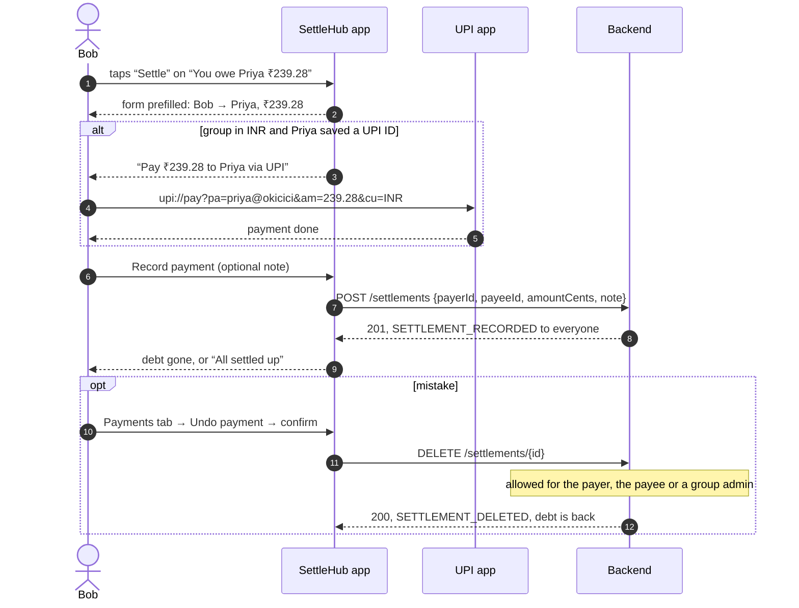

The header's **Settle up** button opens the same form empty, for payments that don't match a
suggested debt.

---

## 7. Invites, joining and claiming an account

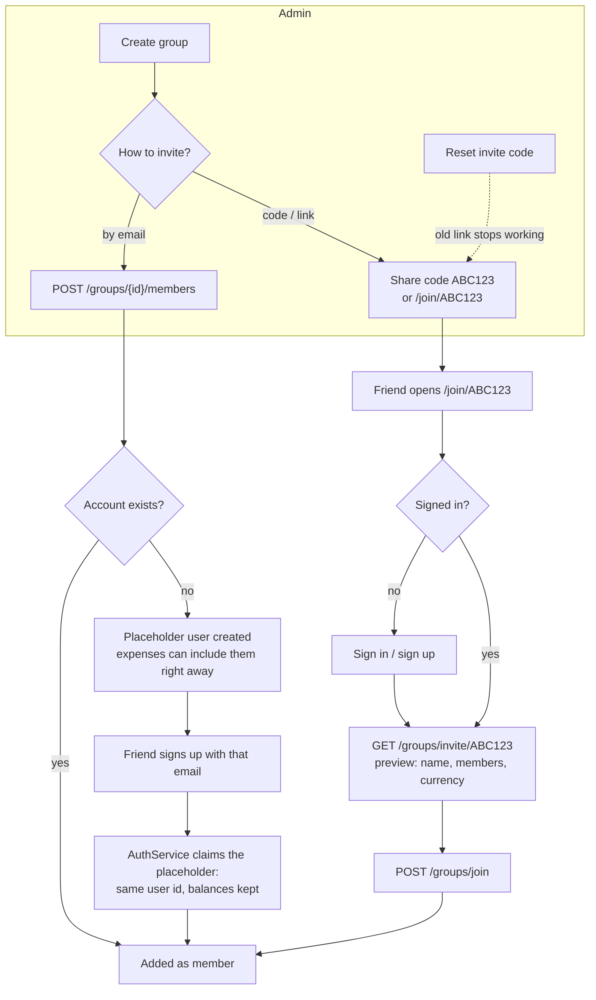

Inside the Android app, invite links use `VITE_PUBLIC_WEB_URL` (the website), because the app's
own address is `https://localhost`. Without it, only the code is shared.

---

## 8. Foreign-currency expenses

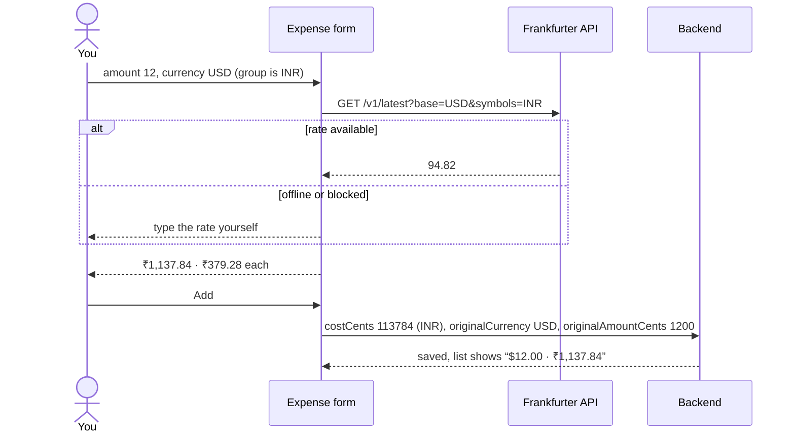

Rates are fetched by the browser only, so the backend has no third-party dependency.

---

## 9. Receipts

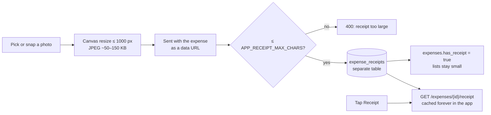

---

## 10. Frontend structure

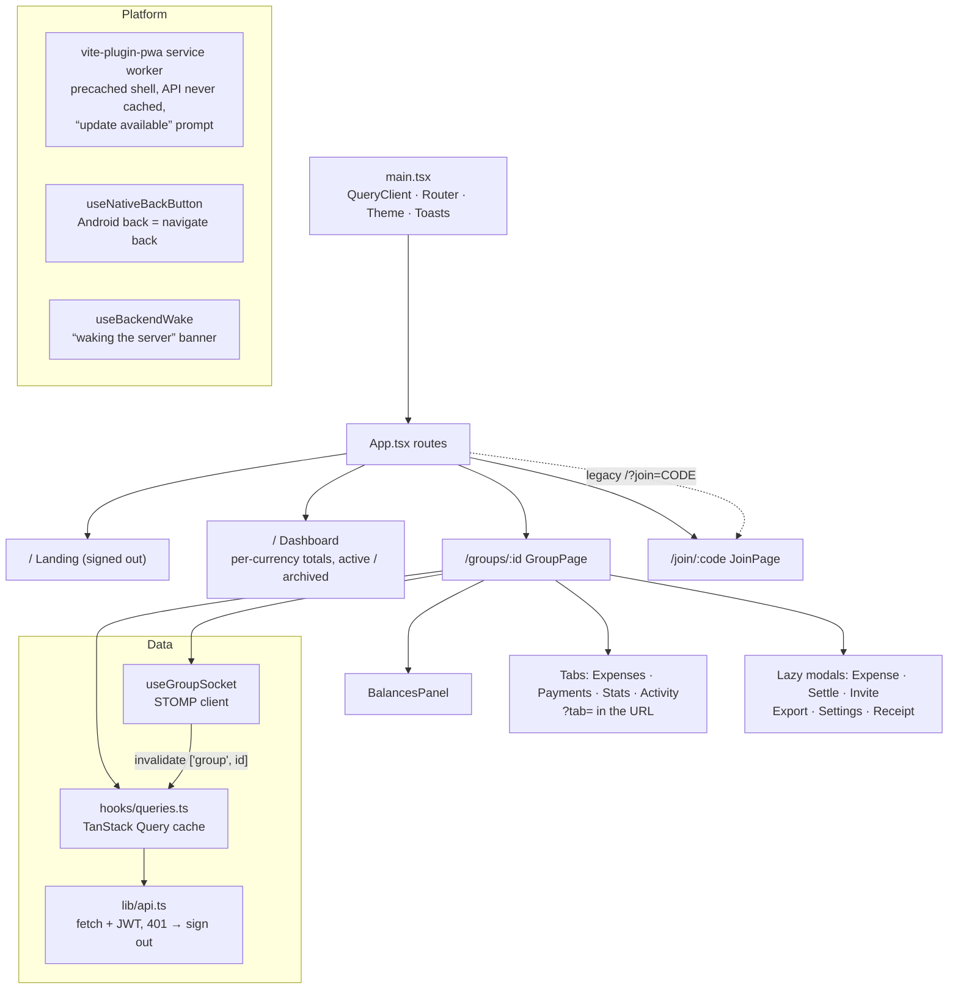

---

## 11. Waking the free backend

Render's free plan stops the backend after 15 idle minutes. The app makes the wait visible
instead of failing.

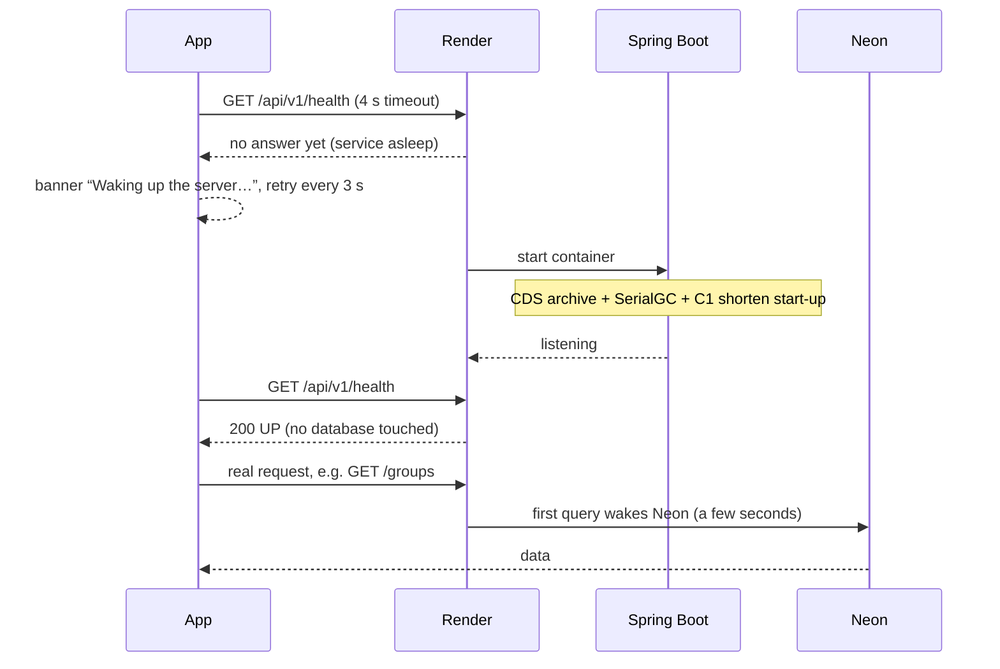

`/api/v1/health` never touches the database, so health checks and the optional keep-warm ping
don't keep Neon awake. `/api/v1/health/ready` does check it.

---

## 12. Upgrading a 2.0 database

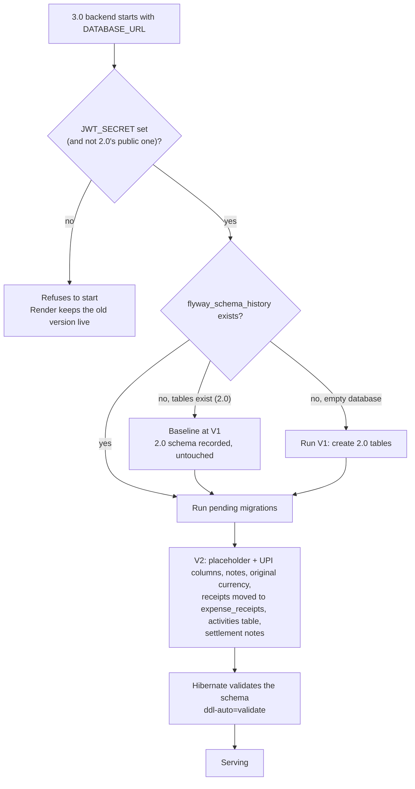

Checked against a real 2.0 PostgreSQL database: balances unchanged, receipts moved, 2.0 logins
still valid when the same secret is kept.

---

## 13. Build, test and release pipeline

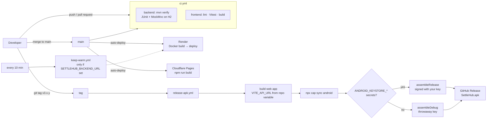

---

## 14. Backend Docker image

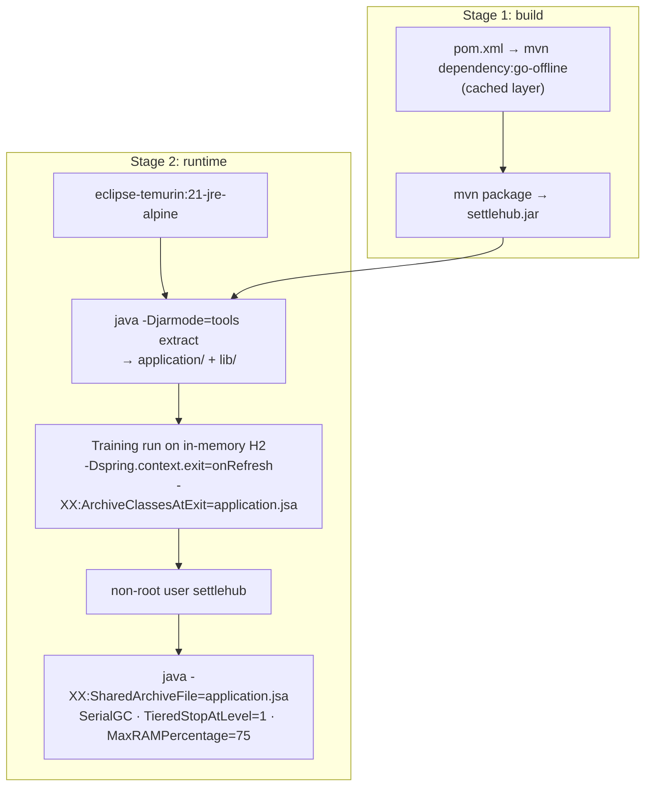

---

## 15. Activity feed events

Written by `ActivityService` in the same transaction as the change; shown on the group's
**Activity** tab, newest first.

| Area | Types |
| --- | --- |
| Group | `GROUP_CREATED`, `GROUP_UPDATED`, `GROUP_ARCHIVED`, `GROUP_RESTORED` |
| Members | `MEMBER_JOINED`, `MEMBER_ADDED`, `MEMBER_REMOVED`, `MEMBER_LEFT`, `ROLE_CHANGED`, `INVITE_RESET` |
| Expenses | `EXPENSE_CREATED`, `EXPENSE_UPDATED` (shows old → new amount), `EXPENSE_DELETED` |
| Payments | `SETTLEMENT_RECORDED`, `SETTLEMENT_DELETED` |
